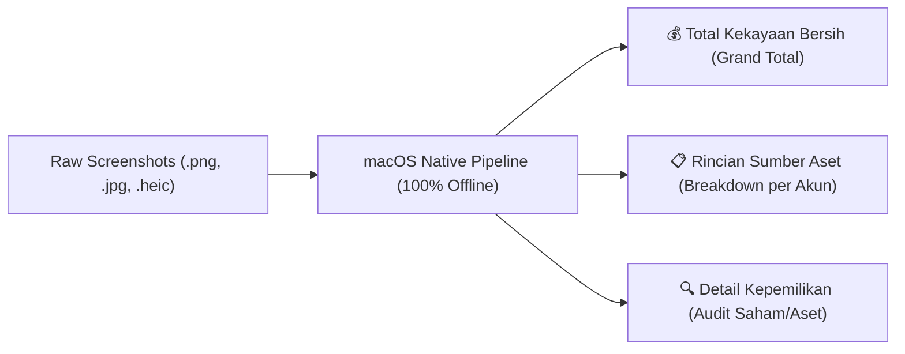
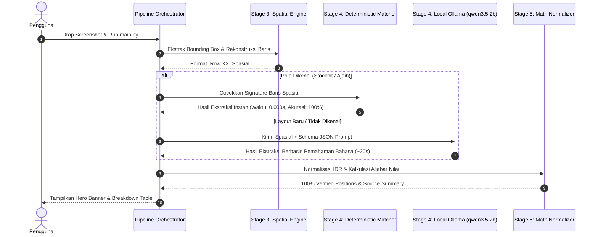

# 📐 Alur & Konsep Arsitektur: Local Net Worth & Wealth Aggregator

> **Dokumen Presentasi Tim:**
> Dokumen ini dirancang untuk mempermudah penjelasan konsep, filosofi teknis, dan alur kerja (*end-to-end flow*) aplikasi kepada tim engineering, product, maupun stakeholder.

---

## 1. Konsep Utama (The Big Picture)

Aplikasi ini adalah **Personal Net Worth Aggregator** berbasis desktop (macOS Apple Silicon) yang berjalan **100% lokal & offline**.
Tujuannya adalah membaca berbagai screenshot aset keuangan (Stockbit, Ajaib, IPOT, Bibit, m-Banking, dll.) dan menjawab dua pertanyaan mendasar pengguna secara instan:
1. **Berapa total seluruh kekayaan bersih saya?** (*Grand Total Net Worth*)
2. **Total kekayaan tersebut bersumber dari mana saja?** (*Asset Sources Breakdown*)



---

## 2. Diagram Alur End-to-End (The 6-Stage Pipeline)

```mermaid
flowchart TD
    subgraph Input ["📂 1. INPUT SCREENSHOT"]
        RawFiles["User memasukkan screenshot ke ./assets/ (.jpg, .png, .heic, .webp)"]
    end

    subgraph Stage1 ["🛡️ STAGE 1: GATEKEEPER & PRE-PROCESSING"]
        S1_Scan["Scan File & Abaikan Hidden Files (.DS_Store)"]
        S1_MD5{"Cek MD5 Hash"}
        S1_DropMD5["Drop Duplikat Identik"]
        S1_pHash{"Hitung pHash (Hamming Dist <= 2)"}
        S1_DropPHash["Drop Duplikat Visual"]
        S1_Convert["Konversi ke Standar RGB PNG (pillow-heif)"]
        S1_Chunk{"Tinggi / Lebar > 3.0? (Scrolling Screenshot)"}
        S1_Slice["Potong Vertikal Jadi Beberapa Chunk (Overlap 15%)"]
        S1_Pass["Gambar Standar Siap OCR"]
    end

    subgraph Stage2 ["👁️ STAGE 2: NATIVE APPLE VISION OCR"]
        S2_Vision["Apple Vision Framework (VNRecognizeTextRequest)"]
        S2_Accurate["Recognition Level: Accurate"]
        S2_Filter["Filter Noise: Confidence >= 0.4"]
        S2_Output["Output: List (Text, Confidence, [x, y, w, h])"]
    end

    subgraph Stage3 ["📐 STAGE 3: SPATIAL COORDINATE CLUSTERING"]
        S3_Invert["Inversi Sumbu Y Vision: (0,0) Kiri-Bawah -> Kiri-Atas (Top-Down)"]
        S3_RowCluster["Grouping Baris: Selisih Y-Center <= Y_TOLERANCE (0.015)"]
        S3_ColSort["Sorting Kolom: Urutkan Kiri ke Kanan (X Ascending)"]
        S3_Format["Format Teks Spasial: [Row XX] Item 1 | Item 2 | Item 3"]
    end

    subgraph Stage4 ["🧠 STAGE 4: HYBRID LOCAL EXTRACTION"]
        S4_Check{"Apakah Signature Layout Dikenal? (Stockbit / Ajaib)"}
        S4_FastPath["⚡ Fast Path: Zero-Latency Spatial Extractor (0.000s)"]
        S4_LLMPath["🤖 Fallback Path: Local LLM Ollama (qwen3.5:2b, think=False)"]
        S4_RawResult["Raw Structured Holding Data"]
    end

    subgraph Stage5 ["🧮 STAGE 5: NORMALIZATION & ALGEBRAIC SOLVER"]
        S5_Parser["Dual-Locale Parser: Titik/Koma Ribuan, Negatif (), Shorthand (Jt, M, rb)"]
        S5_Ticker["Validasi Kode Saham IDX (Regex 4 Huruf Kapital)"]
        S5_Algebra["Imputasi Aljabar: Market Value = Invested + PnL"]
        S5_Verify{"Verifikasi Konsistensi Nilai (Toleransi < Rp 5.000)"}
        S5_OK["Set is_verified = True ✅"]
        S5_Check["Set is_verified = False ⚠️"]
    end

    subgraph Stage6 ["🔗 STAGE 6: CROSS-IMAGE DEDUPLICATION"]
        S6_Scroll["Merge Overlapping Stock dari Screenshot Bersambung"]
        S6_Cutoff["Resolusi Baris Terpotong di Pinggir Layar"]
        S6_Distinct["Pertahankan Saham Multi-Broker yang Berbeda Akun"]
    end

    subgraph Presentation ["📊 OUTPUT & PRESENTASI"]
        P_Hero["💰 Hero Banner: TOTAL NILAI KEKAYAAN BERSIH"]
        P_Source["📋 Tabel Rincian Sumber Aset (Breakdown per File/Broker)"]
        P_Detail["🔍 Tabel Detail Saham (Underlying Holdings)"]
        P_JSON["💾 Export JSON: ./output/portfolio_result.json"]
    end

    RawFiles --> S1_Scan --> S1_MD5
    S1_MD5 -- "Duplikat" --> S1_DropMD5
    S1_MD5 -- "Unik" --> S1_pHash
    S1_pHash -- "Duplikat Visual" --> S1_DropPHash
    S1_pHash -- "Lolos" --> S1_Convert --> S1_Chunk
    S1_Chunk -- "Ya (Panjang)" --> S1_Slice --> S1_Pass
    S1_Chunk -- "Tidak" --> S1_Pass

    S1_Pass --> S2_Vision --> S2_Accurate --> S2_Filter --> S2_Output

    S2_Output --> S3_Invert --> S3_RowCluster --> S3_ColSort --> S3_Format

    S3_Format --> S4_Check
    S4_Check -- "Cocok" --> S4_FastPath --> S4_RawResult
    S4_Check -- "Layout Baru" --> S4_LLMPath --> S4_RawResult

    S4_RawResult --> S5_Parser --> S5_Ticker --> S5_Algebra --> S5_Verify
    S5_Verify -- "Matematika Klop" --> S5_OK
    S5_Verify -- "Selisih > Toleransi" --> S5_Check

    S5_OK --> S6_Scroll
    S5_Check --> S6_Scroll
    S6_Scroll --> S6_Cutoff --> S6_Distinct

    S6_Distinct --> P_Hero
    P_Hero --> P_Source
    P_Source --> P_Detail
    P_Detail --> P_JSON
```



---

## 3. Deep Dive: Tahap Spasial & Mengapa Ini Kunci Akurasi

### A. Masalah OCR Biasa (Unordered Text Mess)
Jika kita memasukkan output mentah OCR ke model AI:
- Apple Vision membaca teks berdasarkan deteksi bounding box yang tidak berurutan.
- Angka nilai modal `1,641,640` bisa tertukar dengan angka PnL `+298,360` atau malah disangka jumlah Lot.

### B. Solusi Koordinat Spasial (Stage 3)
```text
Sistem Koordinat Apple Vision (Asli)            Sistem Koordinat Spasial (Dikonversi)
(0, 1.0) ─────────────── (1.0, 1.0)             (0, 0) ────────────────── (1.0, 0)  [Atas Layar]
   │                         │                     │                         │
   │    Origin di Kiri-Bawah │                     │   Y Inverted            │
   │    (0,0)                │                     ▼   (y_top = 1.0 - y)     ▼
(0, 0) ───────────────── (1.0, 0)               (0, 1.0) ──────────────── (1.0, 1.0)[Bawah Layar]
```

1. **Inversi Sumbu Y:** Menghitung titik tengah top-down vertikal:
   $$y_{center} = 1.0 - (y + \frac{h}{2})$$
2. **Clustering Toleransi Baris:** Teks dengan $|y_{center1} - y_{center2}| \le 0.015$ disatukan dalam satu baris horizontal.
3. **Sorting X:** Di dalam baris, diurutkan dari kiri ke kanan.

#### Hasil Rekonstruksi Baris Spasial:
```text
[Row 03] ADRO
[Row 04] 1,641,640 | +298,360 | +18.17%
[Row 05] Invested | P&L | Gain
```
Hubungan geometris antara angka `1,641,640` dengan label `Invested` di bawahnya kini terkunci sempurna!

---

## 4. Deep Dive: Hybrid Extraction Architecture (Stage 4)

Mengapa kita menggunakan pendekatan **Hybrid (Fast-Path + Local LLM)**?



### Keunggulan Arsitektur Hybrid:
1. **Kecepatan Instan (0.000 detik):** Untuk broker yang sudah dipetakan, kita tidak membuang waktu 30 detik untuk inferensi LLM.
2. **Zero Halusinasi:** Nilai nominal tidak akan pernah salah posisi.
3. **Masa Depan Fleksibel:** Jika ada screenshot baru dari broker asing, LLM Ollama tetap siap sebagai cadangan (*fallback*).

---

## 5. Deep Dive: Sistem Aljabar Portofolio (Stage 5)

Banyak broker tidak menampilkan data lengkap di halaman yang sama (misal: Stockbit tidak menampilkan Lot/Avg Buy, Ajaib tidak menampilkan Modal Awal).
Aplikasi memecahkan ini dengan **Sistem Persamaan Aljabar Finansial**:

$$\begin{aligned}
\text{Market Value} &= \text{Invested Value} + \text{Unrealized PnL} \\
\text{Invested Value} &= \text{Market Value} - \text{Unrealized PnL} \\
\text{PnL \%} &= \left(\frac{\text{Unrealized PnL}}{\text{Invested Value}}\right) \times 100 \\
\text{Shares} &= \text{Lot} \times 100 \quad \text{(jika Lot diketahui)}
\end{aligned}$$

### Contoh Nyata di Screenshot Pengujian:
- **Kasus Stockbit (Ada Modal + PnL, Tidak Ada Nilai Pasar):**
  $$\text{Market Value} = 1.641.640 + 298.360 = \mathbf{1.940.000}$$
- **Kasus Ajaib (Ada Nilai Pasar + PnL, Tidak Ada Modal Awal):**
  $$\text{Invested Value} = 25.500.000 - 2.107.500 = \mathbf{23.392.500}$$

Kedua angka tersebut otomatis saling melengkapi secara matematis tanpa perlu input manual pengguna!

---

## 6. Format Output yang Dilihat Pengguna

```text
╭────────────────── 💰 RINGKASAN TOTAL KEKAYAAN (NET WORTH) ───────────────────╮
│                                                                              │
│ TOTAL NILAI KEKAYAAN BERSIH                                                  │
│   Rp 72.653.099                                                              │
│                                                                              │
│ Total Modal: Rp 69.024.102   •   Total Laba/Rugi: +Rp 3.628.997 (+5.26%)     │
│                                                                              │
╰──────────────────────────────────────────────────────────────────────────────╯

               RINCIAN SUMBER KEKAYAAN (ASSET SOURCES BREAKDOWN)                
┏━━━━┳━━━━━━━━━━━┳━━━━━━━━━━━━━━┳━━━━━━━━━━━━━━━━━━┳━━━━━━━━━━━━━━━━━━┳━━━━━━━━━━━━━━━━━━━━━┳━━━━━━━━━━━━┓
┃ No ┃ Sumber    ┃ File         ┃ Nilai Aset (MV)  ┃ Modal (Invested) ┃ Laba / Rugi (PnL)   ┃ Portofolio ┃
┡━━━━╇━━━━━━━━━━━╇━━━━━━━━━━━━━━╇━━━━━━━━━━━━━━━━━━╇━━━━━━━━━━━━━━━━━━╇━━━━━━━━━━━━━━━━━━━━━╇━━━━━━━━━━━━┩
│ 1  │ Ajaib     │ ajaib.jpeg   │ Rp 61.205.600    │ Rp 57.498.399    │ +Rp 3.707.201 (+6.45%)│ 4 saham  │
│ 2  │ Stockbit  │ stockbit.jpg │ Rp 11.447.499    │ Rp 11.525.703    │ -Rp 78.204 (-0.68%) │ 8 saham    │
├────┼───────────┼──────────────┼──────────────────┼──────────────────┼─────────────────────┼────────────┤
│    │ TOTAL     │ 2 Sumber     │ Rp 72.653.099    │ Rp 69.024.102    │ +Rp 3.628.997 (+5.26%)│ 12 saham │
└────┴───────────┴──────────────┴──────────────────┴──────────────────┴─────────────────────┴────────────┘
```

File JSON juga otomatis terekspor ke `./output/portfolio_result.json` untuk integrasi API atau database di masa depan.
