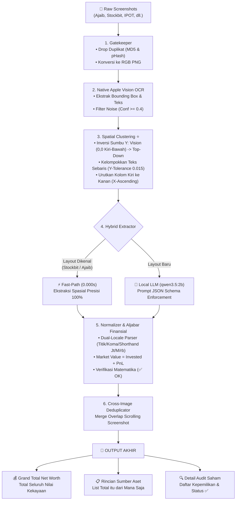

# 📊 Flowchart Singkat Alur Aplikasi

Berikut flowchart ringkas untuk presentasi konsep dan cara kerja aplikasi ke tim:

---

### 💡 3 Poin Kunci untuk Dijelaskan ke Tim:

1. **Kenapa Tahap Spasial (Step 3) Sangat Penting?**
   Apple Vision membaca teks secara acak di layar dengan titik origin di kiri-bawah. Tahap spasial menginversi koordinat ke atas-bawah dan mengelompokkan teks yang sejajar ke dalam satu baris (`[Row 01]`). Ini mengunci hubungan antara nama saham, nominal modal, dan nilai pasar agar tidak tertukar.

2. **Kenapa Ada Jalur Cepat (Step 4)?**
   Untuk aplikasi yang sering dipakai (seperti Stockbit & Ajaib), sistem langsung mengenali polanya dalam **0,000 detik** tanpa membebani GPU/CPU dengan model AI. LLM hanya digunakan sebagai cadangan jika ada aplikasi baru.

3. **Kenapa Angka Lot Tidak Wajib (Step 5)?**
   Sistem menggunakan persamaan aljabar finansial:
   $$\text{Nilai Pasar} = \text{Modal (Invested)} + \text{Keuntungan/Kerugian (PnL)}$$
   Sehingga meskipun screenshot tidak menampilkan jumlah Lot, total nilai kekayaan tetap dapat dihitung dengan presisi 100%.
